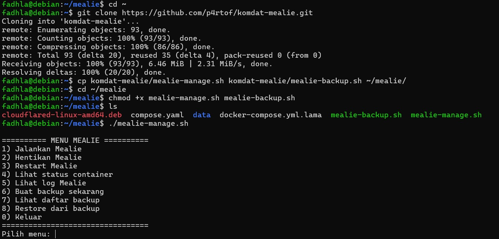
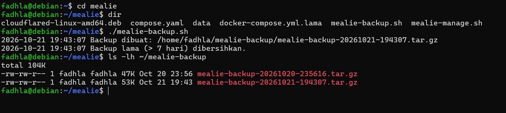
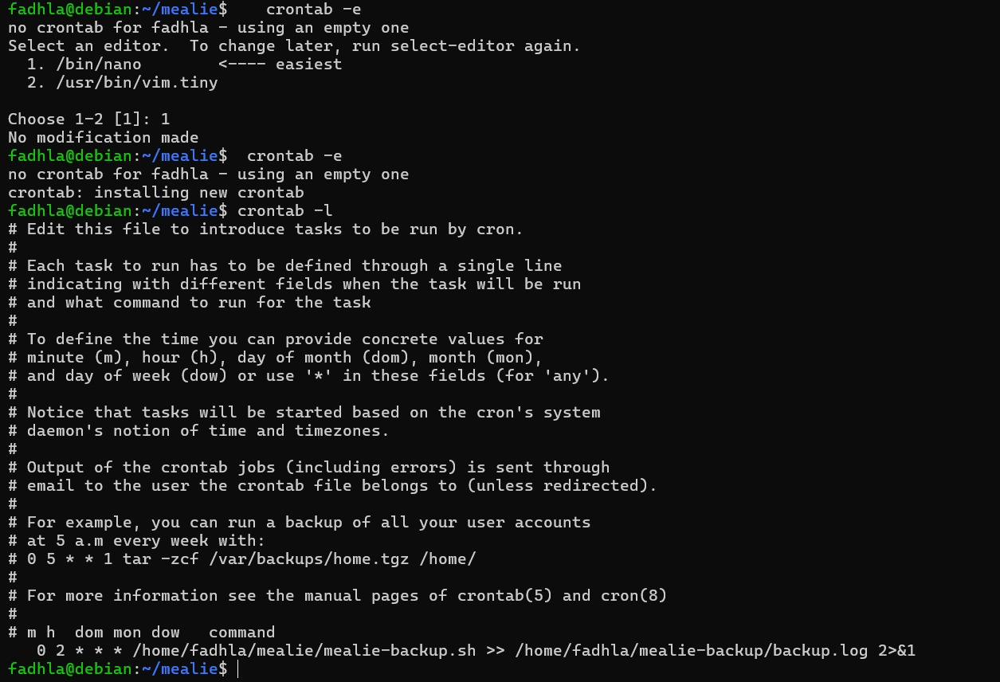

<p align="center">
  
</p>

# Laporan Proyek Akhir: Instalasi Mealie

**Mata Kuliah:** Komunikasi Data dan Jaringan Komputer (KDJK)  
**Kelompok:** 7

| NIM | Nama |
| --- | --- |
| M0403241004 | Fadhla |
| M0403241028 | Nadia Arifatun Nisa |
| M0403241040 | Muhammad Al Fatih |
| M0403241041 | Nadine Putri Agustin |
| M0403241071 | Fahira Fasya |

**Aplikasi:** [Mealie](http://mealie.fatihost.web.id)

---

## Daftar Isi

- [Tentang Mealie](#tentang-mealie)
- [Arsitektur dan kebutuhan sistem](#arsitektur-dan-kebutuhan-sistem)
- [Instalasi](#instalasi)
- [Konfigurasi dan hasil pengujian](#konfigurasi-dan-hasil-pengujian)
- [Otomatisasi](#otomatisasi)
- [Cara Pemakaian](#cara-pemakaian)
- [Pembahasan](#Pembahasan)
- [Referensi](#Referensi)

## Tentang Mealie

Mealie adalah aplikasi manajemen resep dan perencanaan menu berbasis web yang bersifat *open source* dan dapat dipasang di server sendiri (*self-hosted*). Mealie menyediakan fitur untuk menyimpan dan mengimpor resep, merencanakan menu, serta membuat daftar belanja.

Dalam proyek ini, Mealie dijalankan di VM/VPS menggunakan Docker Compose. Domain diarahkan ke aplikasi melalui DNS dan Nginx Proxy Manager.

## Arsitektur dan kebutuhan sistem

Alur akses aplikasi:

```text
Pengguna → Domain/DNS → Nginx Proxy Manager → Mealie di VM/VPS
```

Kebutuhan yang digunakan:

- VM/VPS dengan Ubuntu
- Docker dan Docker Compose
- Domain atau DNS yang mengarah ke server
- Nginx Proxy Manager untuk meneruskan trafik domain ke Mealie

## Instalasi

### 1. Hubungkan ke server

Jalankan SSH dari terminal dan ganti nilai contoh dengan akun serta alamat server yang digunakan:

```bash
ssh <nama-pengguna>@<alamat-ip-server>
```

### 2. Buat direktori kerja

```bash
mkdir -p ~/mealie
cd ~/mealie
```

### 3. Buat konfigurasi Docker Compose

Buat file `docker-compose.yaml`:

```bash
nano docker-compose.yaml
```

Isi file dengan konfigurasi berikut:

```yaml
version: "3"

services:
  mealie:
    image: ghcr.io/mealie-recipes/mealie:latest
    container_name: mealie
    restart: unless-stopped
    ports:
      - "9000:9000"
    volumes:
      - ./data:/app/data/
    environment:
      - PUID=1000
      - PGID=1000
      - TZ=Asia/Jakarta
      - BASE_URL=https://mealie.fatihost.web.id
      - BRANDING_NAME=Resep Kita
      - API_DOCS=false
      - LOG_LEVEL=debug
    deploy:
      resources:
        limits:
          memory: 1000M
```

Port `9925` adalah port pada server, sedangkan `9000` adalah port di dalam container. Data aplikasi disimpan pada direktori `./data`.

### 4. Jalankan dan periksa container

```bash
docker compose up -d
docker compose ps
docker compose logs mealie
```

Pastikan container Mealie berjalan. Pada konfigurasi di atas, aplikasi dapat dijangkau dari server melalui port `9925`.

### 5. Arahkan domain melalui DNS dan Nginx Proxy Manager

1. Buat record DNS yang mengarah ke alamat IP server.
2. Di Nginx Proxy Manager, tambahkan *proxy host* untuk domain tersebut.
3. Arahkan *forward hostname/IP* ke server tempat Mealie berjalan dan *forward port* ke `9925`.
4. Simpan konfigurasi, lalu uji akses melalui domain aplikasi.

Jika Nginx Proxy Manager berada di server yang berbeda, gunakan alamat IP server Mealie yang dapat dijangkau dari Nginx Proxy Manager.

## Konfigurasi dan hasil pengujian

Mealie dikonfigurasi di dua tempat:

* **File `docker-compose.yml`** untuk pengaturan server: port, penyimpanan data, batas memori, dan variabel lingkungan. File ini dibaca saat container dimulai, sehingga setiap perubahan diterapkan dengan perintah berikut. Data aplikasi tetap aman karena tersimpan di volume.

  ```
  $ docker compose up -d
  ```

* **Menu admin di aplikasi** untuk pengaturan aplikasi, seperti pengguna dan hak akses. Perubahan di sini langsung berlaku tanpa memulai ulang container.

| Pengaturan | Fungsi |
|---|---|
| `image` | Versi Mealie yang dijalankan. `latest` berarti rilis terbaru. |
| `container_name` | Nama container agar mudah dipanggil. |
| `restart: unless-stopped` | Container otomatis berjalan kembali saat Docker atau server dimulai ulang atau saat terjadi crash, kecuali jika container dihentikan secara manual oleh pengguna. |
| `ports` | Format `port-host:port-container`. Angka kiri adalah pintu di server, angka kanan adalah pintu di dalam container. |
| `volumes` | Penyimpanan permanen tempat data resep dan akun disimpan. |
| `ALLOW_SIGNUP` | Pendaftaran tanpa token. Bawaan Mealie `false`, kita memakai `true`. |
| `PUID` dan `PGID` | Pemilik file data. Bawaan `911`, kita memakai `1000` agar sesuai dengan pengguna di server. |
| `TZ` | Zona waktu server. Bawaan `UTC`, kita memakai `Asia/Jakarta`. |
| `BASE_URL` | Alamat dasar aplikasi untuk notifikasi dan alamat callback OIDC. Bawaan `http://localhost:9000`, kita memakai domain aplikasi (https://mealie.fatihost.web.id). |

### Port aplikasi

Port host dapat diubah tanpa mengubah port internal Mealie. Pada pengujian, konfigurasi `8080:9000` membuat aplikasi dapat diakses melalui `localhost:8080`, sedangkan `localhost:9000` tidak lagi dapat dibuka.


### Penyimpanan data

Konfigurasi Compose menggunakan bind mount `./data:/app/data` agar data aplikasi disimpan di direktori `data` pada server dan tetap tersedia setelah container dibuat ulang.

### Kebijakan restart

Container menggunakan `restart: unless-stopped`, sehingga Docker akan mencoba menjalankannya kembali setelah berhenti, kecuali container dihentikan secara manual.

### Batas memori

Batas memori pada konfigurasi ditetapkan sebesar `1000M`:

```yaml
deploy:
  resources:
    limits:
      memory: 1000M
```
 

### Logging

`LOG_LEVEL=debug` digunakan saat pengujian untuk menampilkan log yang lebih terperinci selama tahap pengujian dan evaluasi deployment domain untuk memudahkan melakukan pelacakan kendala (*trouleshooting*).

Untuk memantau log aktivitas sistem secara langsung (*real-time*) selama masa pengujian, jalankan perintah berikut di terminal server: 

```
docker compose logs -f
```

### Dokumentasi API

Pada pengujian, dokumentasi API dinonaktifkan menggunakan `API_DOCS=False`. Halaman `/docs` kemudian menampilkan `404 Not Found`.


### Kustomisasi nama aplikasi

`BRANDING_NAME` dapat digunakan untuk mengubah nama yang ditampilkan pada aplikasi. Pada pengujian, nama aplikasi diubah menjadi **Resep Kita**.


### Manajemen pengguna

Pengaturan pengguna dan hak akses tersedia melalui menu administrasi. Pada pengujian, pengguna non-admin tidak dapat membuka halaman **Site Settings**.


 

## Otomatisasi

Agar pengelolaan Mealie tidak perlu mengetik perintah berulang kali, tersedia dua script shell:

- [`mealie-manage.sh`](./mealie-manage.sh): menu interaktif untuk menjalankan, menghentikan, memeriksa, mem-backup, dan me-restore Mealie.
- [`mealie-backup.sh`](./mealie-backup.sh): backup otomatis tanpa menu (dijalankan oleh cron). Yang dicadangkan adalah folder `data` dan file `compose.yaml`, disimpan di `~/mealie-backup`. Backup yang lebih tua dari 7 hari dihapus otomatis.

### 1. Script Pengelolaan Interaktif

Salin kedua script ke direktori `~/mealie`, lalu beri izin eksekusi dan jalankan:

```bash
cd ~/mealie
chmod +x mealie-manage.sh mealie-backup.sh
./mealie-manage.sh
```


Menu yang tersedia:

| Pilihan | Fungsi |
|---|---|
| 1 | Jalankan Mealie |
| 2 | Hentikan Mealie |
| 3 | Restart Mealie |
| 4 | Lihat status container |
| 5 | Lihat log Mealie |
| 6 | Buat backup sekarang |
| 7 | Lihat daftar backup |
| 8 | Restore dari backup |
| 0 | Keluar |

### 2. Backup Otomatis dengan Cron

Uji script backup secara manual terlebih dahulu:

```bash
~/mealie/mealie-backup.sh
ls -lh ~/mealie-backup
```


Lalu buka crontab dengan `crontab -e` dan tambahkan baris berikut (ganti `<nama-pengguna>` dengan nama pengguna di server):

```
0 2 * * * /home/<nama-pengguna>/mealie/mealie-backup.sh >> /home/<nama-pengguna>/mealie-backup/backup.log 2>&1
```

Artinya backup dijalankan **setiap hari pukul 02.00** (mengikuti jam server), dan hasilnya dicatat di `backup.log`. Periksa jadwal yang aktif dengan:

```bash
crontab -l | grep -v '^#'
```


### Catatan

- Untuk menguji cron tanpa menunggu pukul 02.00, ubah jadwal sementara menjadi `* * * * *` (tiap menit), cek `ls -lh ~/mealie-backup`, lalu kembalikan ke `0 2 * * *`.
- Salinan backup sebaiknya juga disimpan di luar server, misalnya diunduh dengan `scp`.

## Cara Pemakaian

Mealie merupakan aplikasi manajemen resep berbasis web yang memudahkan pengguna untuk menyimpan, mengelola, dan merencanakan menu makanan. Berikut tahapan penggunaan Mealie beserta fitur-fitur pendukungnya.

### 1. Login dan Akses Awal

#### a. Login

Pengguna yang telah memiliki akun dapat masuk ke aplikasi Mealie melalui halaman login.


#### b. Registrasi dan Akses Grup

Pengguna yang belum memiliki akun dapat melakukan registrasi melalui halaman yang tersedia. Pada halaman tersebut, pengguna dapat memilih **Join a Group** untuk bergabung dengan grup atau **Create a New Group** untuk membuat grup baru.


#### c. Dashboard

Setelah berhasil masuk, pengguna akan diarahkan ke dashboard sebagai halaman utama untuk mengakses fitur Mealie.


### 2. Melihat dan Menambahkan Resep

#### a. Melihat Detail Resep

Pengguna dapat membuka resep yang tersedia untuk melihat informasi resep, termasuk bahan-bahan dan langkah pembuatannya.


#### b. Memilih Metode Penambahan Resep

Melalui menu **Create**, pengguna dapat memilih untuk membuat resep secara manual atau mengimpor resep menggunakan URL.


#### c. Membuat Resep Secara Manual

Pengguna dapat memasukkan informasi resep melalui formulir yang tersedia, termasuk bahan-bahan yang dibutuhkan.


#### d. Mengimpor Resep dari URL

Pengguna dapat memasukkan URL halaman resep dari situs web. Setelah URL diproses, pengguna dapat meninjau ringkasan hasil parsing dan memeriksa bahan-bahan yang dikenali sebelum melihat hasil impor di aplikasi.

Pada pengujian ini, URL resep **Es Teler** dari [Cookpad](https://cookpad.com/id/resep/26277768) digunakan sebagai sumber impor.

1. Memasukkan URL resep:

   

2. Meninjau ringkasan hasil parsing:

   

3. Memeriksa bahan resep:

   

4. Melihat hasil impor:

   

### 3. Fitur Pendukung

Selain melihat, membuat, dan mengimpor resep, Mealie menyediakan fitur pendukung untuk membantu pengguna mengatur resep serta merencanakan aktivitas memasak.

#### a. Recipes

Menu Recipes menampilkan resep yang tersimpan di Mealie. Pengguna dapat membuka resep untuk melihat bahan dan langkah pembuatannya.


#### b. Recipe Finder

Recipe Finder membantu pengguna mencari resep yang tersedia di dalam aplikasi.


#### c. Meal Planner

Meal Planner digunakan untuk menyusun dan melihat rencana menu berdasarkan jadwal.


#### d. Shopping Lists

Shopping Lists membantu pengguna menyusun daftar belanja bahan makanan.


#### e. Timeline

Timeline menampilkan informasi aktivitas berdasarkan urutan waktu sesuai informasi yang tersedia di aplikasi.


#### f. Cookbooks

Cookbooks menampilkan kumpulan resep yang disusun dalam buku resep.


#### g. Organizers

Organizers menyediakan halaman Categories, Tags, dan Tools untuk mengatur informasi resep.

**Categories**


**Tags**


**Tools**


## Pembahasan

Berdasarkan hasil analisis, Mealie memiliki sejumlah kelebihan dan kekurangan yang dapat menjadi bahan pertimbangan bagi pengguna.

### Kelebihan

- Mendukung penyimpanan data secara *self-hosted*, sehingga pengelola dapat menentukan lokasi penyimpanan serta mengatur akses terhadap data resep dan rencana menu.
- Memfasilitasi impor resep dari situs web yang kompatibel melalui URL.
- Menyediakan fitur *meal planner* dan pembuatan daftar belanja berdasarkan resep.
- Mendukung beberapa pengguna dalam satu grup, dengan pembagian hak akses, sehingga resep dan rencana makan dapat dikelola bersama.
- Menyediakan REST API yang dapat dimanfaatkan untuk mengintegrasikan atau mengotomatiskan pengelolaan resep, rencana makan, dan daftar belanja.

### Kekurangan

- Pengguna perlu menyiapkan server dan Docker karena Mealie dijalankan secara *self-hosted*, bukan dipasang seperti aplikasi desktop biasa.
- Resep yang tersimpan di server tidak dapat diakses jika server atau koneksi ke server mengalami gangguan.
- Pembaruan aplikasi perlu dikelola sendiri. Perubahan versi dapat memerlukan penyesuaian atau migrasi database.
- Hasil impor resep melalui URL perlu diperiksa kembali karena keberhasilannya bergantung pada dukungan dan struktur situs sumber.
- Mealie belum mendukung seluruh pilihan bahasa, sehingga pengguna perlu menyesuaikan penggunaan aplikasi dengan bahasa yang tersedia.
- Untuk penggunaan dengan banyak pengguna atau fitur pencarian tertentu, pengguna perlu mempertimbangkan konfigurasi dan kebutuhan database, termasuk PostgreSQL.

### Perbandingan Mealie, Tandoor, dan KitchenOwl

| Aspek | Mealie | Tandoor | KitchenOwl |
|---|---|---|---|
| **Fokus utama** | Pengelolaan resep, perencanaan menu, dan daftar belanja secara *self-hosted*. | Pengelolaan resep dan perencanaan makanan. | Daftar belanja dan pengelolaan resep, dengan fitur pencatatan pengeluaran rumah tangga. |
| **Pengelolaan resep** | Mendukung kategori, tag, pencarian, dan pengeditan resep. Fitur *fuzzy search* memerlukan PostgreSQL. | Mendukung pengelompokan resep dalam *cookbook*, kategorisasi, dan berbagi resep. | Mendukung pengelolaan resep serta penggunaan resep dalam daftar belanja. |
| **Impor resep** | Mendukung impor dari URL situs yang kompatibel dan input resep secara manual. | Mendukung impor dari situs yang menyediakan data resep dalam format seperti JSON-LD atau microdata, serta impor koleksi dari sejumlah aplikasi pengelola resep. | Mendukung impor resep melalui URL menurut informasi yang tersedia; dukungannya dapat berbeda sesuai versi. |
| **Perencanaan menu** | Menyediakan *meal planner* untuk menyusun menu berdasarkan jadwal. | Mendukung perencanaan beberapa waktu makan dalam satu hari. | Menyediakan fitur *meal plan* untuk merencanakan menu. |
| **Daftar belanja** | Item dapat ditambahkan langsung atau dibuat dari resep, termasuk bahan-bahannya. | Daftar belanja dapat dibuat dari rencana makan atau resep. | Mendukung sinkronisasi daftar belanja antar pengguna dan penggunaan offline secara terbatas. |
| **Self-hosting** | Dapat dijalankan menggunakan Docker Compose. | Dapat dijalankan secara lokal atau di belakang *reverse proxy*, termasuk menggunakan Docker. | Dapat dijalankan menggunakan Docker dengan layanan web dan backend. |

### Kesimpulan

- **Mealie** mengutamakan kemudahan dalam mengelola resep, mengimpor resep dari web, merencanakan menu, dan membuat daftar belanja. Aplikasi ini sesuai bagi pengguna yang ingin mengelola kebutuhan memasak secara terpusat melalui server sendiri.
- **Tandoor** menawarkan fitur pengelolaan resep dan perencanaan makanan yang lebih beragam, termasuk pengelompokan resep dalam *cookbook* dan pengaturan koleksi.
- **KitchenOwl** berfokus pada kolaborasi daftar belanja dan pengelolaan kebutuhan rumah tangga. Aplikasi ini menyediakan sinkronisasi antar pengguna serta fitur pencatatan pengeluaran.

## Referensi

1. [Dokumentasi Tandoor Recipes](https://docs.tandoor.dev/) — Tandoor
2. [Home - Mealie](https://mealie.io/) — Mealie
3. [Mealie Review 2026: Honest Pros, Cons & Who It's For](https://cooklang.org/blog/40-mealie-review/) — Cooklang
4. [Mealie vs Tandoor Recipes: Which to Self-Host? (2026)](https://selfhostatlas.com/compare/mealie-vs-tandoor) — SelfHost Atlas
5. [Mealie vs Tandoor: Which Self-Hosted Recipe Manager to Run](https://homelabhaven.com/posts/self-hosted-recipes-mealie-tandoor/) — Homelab Haven
6. [Tandoor vs Mealie vs KitchenOwl: Choosing a Self-Hosted Recipe Manager in 2026](https://cooklang.org/blog/42-tandoor-vs-mealie-vs-kitchenowl/) — Cooklang
7. [TomBursch/kitchenowl](https://github.com/tombursch/kitchenowl) — GitHub
